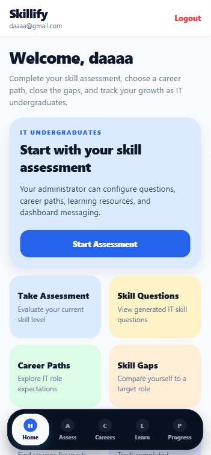
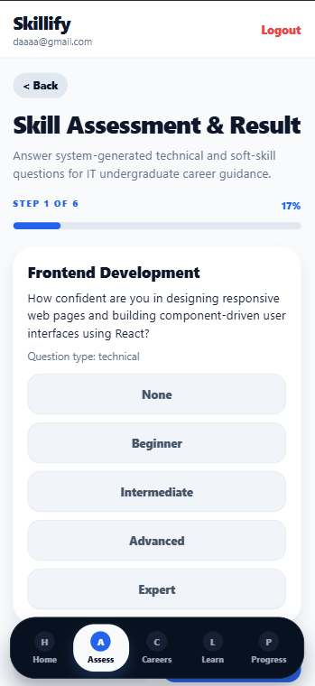
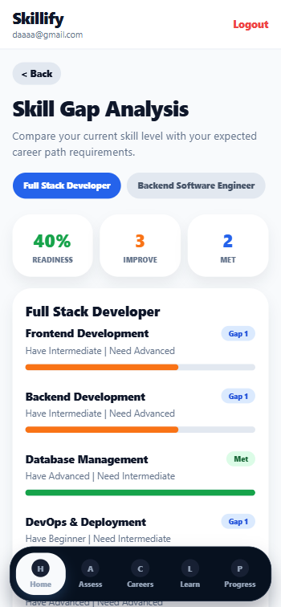
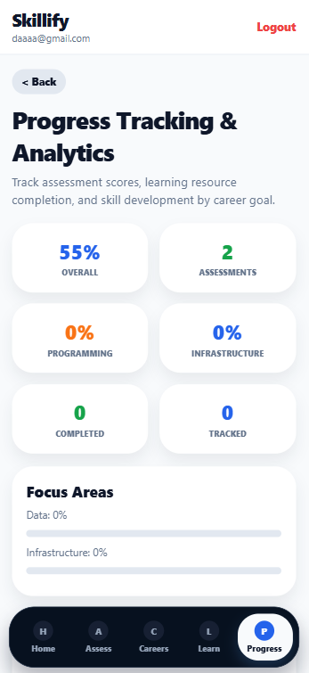

# Skillify

Skillify is a career skill-gap guidance app for IT undergraduates. Students can
complete a technical assessment, compare their skills with career paths, find
learning resources, and track progress. Administrators can manage the
questions, career paths, resources, users, assessments, and dashboard settings.

## Project structure

- `SKILLIFY-Frontend-main/` - Expo React Native application with web support.
- `SKILLIFY-Backend-main/SKILLIFY-Backend-main/` - Express and MongoDB API.
- `docs/screenshots/` - portfolio screenshots of the main student workflows.

## Requirements

- Node.js 18 or newer
- npm
- MongoDB (local or MongoDB Atlas)

## Setup

1. Install the frontend dependencies:

   ```powershell
   cd SKILLIFY-Frontend-main
   npm install
   Copy-Item .env.example .env
   ```

2. Set the frontend API URL in `.env`. For local web development, the
   defaults in `.env.example` use `http://localhost:5000`. For a phone or
   another device, set `EXPO_PUBLIC_API_URL` to the computer's LAN address.

3. Install the backend dependencies and create its local environment file:

   ```powershell
   cd ..\SKILLIFY-Backend-main\SKILLIFY-Backend-main
   npm install
   Copy-Item .env.example .env
   ```

4. Update the backend `.env` with a real `MONGODB_URI`, a long random
   `JWT_SECRET`, and a private `ADMIN_PASSWORD`. The values in
   `.env.example` are demonstration placeholders only and must not be used
   for a deployed environment.

5. Start the API:

   ```powershell
   npm run dev
   ```

   The API listens on `http://localhost:5000` by default. On startup it
   creates the configured admin account and idempotently seeds the demo
   questions, career paths, resources, and app settings.

6. In a second terminal, start the web client:

   ```powershell
   cd ..\..\SKILLIFY-Frontend-main
   npm run web
   ```

   Open the URL printed by Expo, normally `http://localhost:8081`.

## Demo seed data

The backend startup seed creates:

- five skill questions covering frontend, backend, databases, DevOps, and
  problem solving;
- three career paths: Full Stack Developer, Backend Software Engineer, and
  Frontend Engineer;
- five free learning resources; and
- the Skillify app settings and configured admin account.

The optional `POST /api/seed` endpoint repeats this idempotent seed operation.
It requires a valid bearer token for the configured admin account. It rejects
unauthenticated requests and student accounts.

## Web-only testing disclosure

The validated smoke test was performed in the Expo web target. Native Android
and iOS builds were not run in this environment; device-specific behavior,
native permissions, and production mobile packaging still require validation
on the target platforms.

## Screenshots

| Dashboard | Assessment |
| --- | --- |
|  |  |

| Skill gap analysis | Progress analytics |
| --- | --- |
|  |  |

## Group credit

Skillify is a group project. Credit belongs to the Skillify project team for
the product design, frontend, backend API, database integration, testing, and
documentation.

## License

Existing project licenses are preserved in their respective project
directories. No license files were changed.
